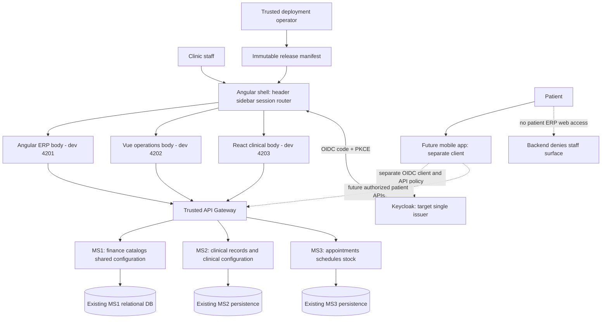

# Configurable dental ERP: proposed system design

**Status: proposed architecture, not implemented or production-certified.**
Build one staff workspace for one clinic, retaining the existing Angular/Vue/React
applications and MS1/MS2/MS3 backends. Make supported presentation and business
policies configurable through validated, versioned settings; keep authorization,
clinical integrity and financial correctness enforced by the owning backend.
Patients remain domain records, but have no patient access to the ERP web app.
A future mobile app is a separate API client, not another ERP role or remote.

## 1. Decision context and review map

The latest scope correction is authoritative:

> Elimina al paciente, no tendrá acceso al software, habrá una app móvil para él. Ahora quiero que haga el system design para el ERP, la idea es que todo lo posible sea configurable por el usuario

Read sections 2–4 for boundaries, 5–7 for configuration and security, and 8–11
for offline safety, acceptance and delivery prerequisites. This is architecture
advice, not UI mockups, application implementation or infrastructure changes.

| Decision | Rationale and constraint |
| --- | --- |
| One clinic, three initial staff profiles | Administrador, Recepcionista and Medico are editable application role compositions, not permanent frontend branches. |
| One shell-owned workspace | Header, sidebar, session and router belong to the shell; remotes render business bodies only. |
| Keep existing service boundaries | MS1 owns finance/master data, MS2 clinical records, MS3 scheduling/stock; no new BFF or microservice is needed. |
| Shared configuration is an MS1 module | Use its current relational database, audited revisions and existing deployment boundary; module-specific rules stay with MS2/MS3. |
| Separate identity from application policy | Keycloak authenticates; backend application permissions and resource checks decide staff actions. |
| Configuration, not executable customization | Schemas, allowlisted views and approved theme tokens replace arbitrary scripts, CSS, URLs or low-code logic. |
| Immutable independent frontend releases | Operators select trusted releases; clinic users cannot edit the executable remote registry. |
| Correctness before offline convenience | Queued work is not posted or paid; retries obey real authorization and bounded idempotency. |

### Current evidence versus target

Repository sources below were read directly. External infrastructure facts are
parent-verified source evidence supplied for this design, not fresh deployment
checks or proof of a working integrated environment.

| Current evidence | Target implication |
| --- | --- |
| [Root overview](../README.md) and [deployment guide](platform-deployment.md): independent immutable releases, trusted manifest and gateway bases. | Preserve deployment independence and operator-only code selection. |
| [Shell bootstrap](../apps/shell/src/bootstrap.ts): header/application navigation and lazy remote routes, no sidebar. | Add business navigation and shared chrome; do not describe them as finished. |
| [Shell platform](../apps/shell/src/platform.ts): on-demand `kc_token` from localStorage. | Replace storage-based session assumptions with shell-managed OIDC and an in-memory access-token capability. |
| [v1 declarations](../packages/mfe-contract/index.d.ts): `path`, API base, token capability, mount/update/unmount; no `activeView` or session/config versions. | Negotiate a compatible extension; current v1 remains supported. |
| [ERP auth](../apps/mf-erp/src/app/core/auth/auth-context.service.ts): fixed raw roles; `financialUserId` confirmed only for local mock mapping. | Require a real backend identity-to-user/financial-actor contract before money writes. |
| [Company/security catalog](../apps/mf-erp/src/app/features/catalogs/company-security.component.ts): clinic form, fixed role choices, ADMIN gating, audit display. | Extend existing administration rather than create a competing settings authority. |
| [Vue app](../apps/mf2-vue-wendy/src/App.vue) and [React app](../apps/mf3-react-henry/src/App.jsx): own headings/navigation. | Split standalone wrappers from embedded body rendering; avoid duplicate chrome/logins. |
| [Vue remote](../apps/mf2-vue-wendy/src/remote.js) and [React lifecycle](../apps/mf3-react-henry/src/remote-session.js): route-driven lifecycle. | Preserve old paths and mount/update/unmount behavior. |
| [React remote](../apps/mf3-react-henry/src/remote.jsx) injects the history client, but [study service](../apps/mf3-react-henry/src/api/estudios.service.js) imports a singleton [HTTP client](../apps/mf3-react-henry/src/api/client.js). | Migrate every service to the host token/base capability; remove production query/storage endpoint overrides. |
| [Gateway configuration](https://github.com/AI-Dentist/platform-infrastructure/blob/main/gateway/nginx/gateway.conf): public ERP rewrite and separate REST/export routes. | Use public gateway contracts, never direct backend URLs. |
| [Identity guide](https://github.com/AI-Dentist/platform-infrastructure/blob/main/identity/keycloak/README.md): ERP `dental-platform` versus legacy `odontoclinic-realm`. | A shared working session is not proven; controlled issuer migration is a prerequisite. |

## 2. System boundaries and retained capabilities

### Context and containers



Arrows to the gateway represent authenticated business calls. OIDC login and
remote/model asset delivery use separately approved origins and are not business
API bypasses. Deployment ports identify development apps, not production routing.
The mobile boundary reserves a distinct client/audience/resource policy; it does
not claim patient endpoints or a mobile implementation already exist.

| Body / service | Retained business responsibilities |
| --- | --- |
| Angular ERP / MS1 | Financial dashboard in Bs, expenses, billing, cash, installments, QR payment and receipts; patients, dentists, consultorios, clinic and tariff master catalogs. |
| Vue Operations / MS3 | Appointments, professional/consultorio schedules and inventory/stock alerts. |
| React Clinical / MS2 | History, antecedents, consultations, odontogram and studies; current study content is text-oriented, not proven image analysis. |
| Existing ERP advanced tools | Preserve local AI, agents, MCP and reports as secondary supported modules; no expansion or claim of backend ML. |

Patients, their histories, appointments, invoices and legal audit records remain.
A person who is both patient and employee may enter only through an explicitly
assigned active staff entitlement; patient identity alone grants no ERP access.
Backend staff-surface checks must reject patient-only tokens even on direct API
calls; hiding sidebar entries is never the enforcement boundary.

### Gateway and token boundary

- Public ERP calls use `POST /api/erp/graphql`, rewritten internally to `/graphql`;
  direct public `/graphql` returns 404. GraphQL HTTP 200 can still contain errors.
- Operations use `/api/agendamiento/**`; Clinical uses `/api/expediente/**`.
  Binary report exports use `/api/v1/reports/export`, not the GraphQL endpoint.
- All business fetches/downloads use the configured, allowlisted gateway and the
  current Bearer access token. Current integration reads `kc_token`; it is not
  evidence of token verification, refresh, logout or shared-origin sessions.
- Validate destination origin and allowed path before attaching credentials.
  Reject arbitrary base overrides and credential-bearing cross-origin redirects.
  Never forward the token to signed storage URLs, model hosts or remote assets.
- Existing report endpoints are compile-time configured; migrate to the trusted
  gateway contract. External signed receipt URLs require an approved gateway
  route/proxy contract before authenticated receipt download can be enabled.
- The test `/api/v1/webhooks/pagofacil` has a mock secret. It is not production
  payment verification and must not be treated as proof that a QR payment settled.
- Gateway CORS currently allows 4201/5173, not shell 4200; MS2 headers/methods are
  not harmonized. Explicit origin/preflight/download checks are release gates.

## 3. One workspace, independently deployed bodies

Use business-oriented groups: Overview; Patients; Agenda; Clinical care;
Billing and cash; Inventory; Catalogs; Administration; and secondary Advanced.
These are proposed presentation groups, not new services or permission grants.
The shell maps each allowed action to an existing remote route/view catalog.

The shell owns responsive header/sidebar, breadcrumbs, global session/logout,
loading/error boundaries, focus restoration and URL/history. Remotes own domain
forms, tables and local task state. Keep separate standalone wrappers so each app
still runs independently for development; embedded bodies have no second login,
header, sidebar or global footer. This design does not deliver a finished UI.

Use consistent semantic design tokens for spacing, typography, color and states,
including Shadow DOM token propagation. Require keyboard navigation, skip links,
visible focus, accessible names, contrast, reduced-motion support and responsive
collapsed navigation. Do not share Angular runtime state with Vue/React; share
compile-time contracts and CSS tokens, preserving bundled framework boundaries.

### Proposed contract evolution, not current interfaces

Retain v1 `path`, `basePath`, `apiBaseUrl`, `getAccessToken`, `onNavigate` and
mount/update/unmount. Define negotiated optional capabilities for embedded chrome,
read-only session/config snapshots and `sessionVersion`/`configVersion` updates.
An optional `activeView` is derived FROM the canonical shell route, never a second
independently mutable router state. Remotes continue accepting v1-only contexts.

Use a code-owned route/view whitelist. For example, the business label Inventario
maps to the existing Vue `stock` path, and Antecedentes to React `actualizar`, not
silently to unsupported `inventario` or `antecedentes` lifecycle values. Preserve
deep links, back/forward and old paths through explicit compatible mappings.
User menu ordering and favorites can reference only known, permissioned entries;
users cannot register remote URLs, import modules or inject executable routes.
ERP's federation route factory needs equivalent session/config adapters without
changing Vue/React lifecycle semantics or forcing synchronized releases.

## 4. Identity, dynamic roles and authority

Target one identity issuer and one public shell OIDC authorization-code + PKCE
client. Keep access tokens in memory and expose a current-token capability;
refresh/logout belong to the shell, with expiry, renewal failure and multi-tab
session termination handled explicitly. Do not serialize tokens into config,
URLs, logs, remote context snapshots or offline queues.

ERP currently recognizes `ADMIN`, `RECEPCIONISTA`, `CAJERO`, `ODONTOLOGO` in
`dental-platform`; legacy clients use `ROLE_*` in `odontoclinic-realm`. Inventory
issuer/audience/subject relationships, validate token exchange requirements if
needed, and migrate in controlled stages. Do not delete the legacy realm or
rename display labels to pretend the incompatible identities are unified.

Keycloak owns credentials, identity lifecycle and issuer/audience claims.
The application owns staff activation, role composition, permission assignments
and domain/resource authorization. Avoid two independently editable permission
stores: legacy realm-role adapters are explicit temporary mappings, not a second
source of grants. Services validate trusted issuer, audience, expiry and active
application membership, then consult versioned application policy fail-closed.

| Initial profile | Proposed starting composition, subject to clinic approval |
| --- | --- |
| Administrador | Manage clinic settings and authorized staff policy; inspect audit; finance only with the required actor entitlement. |
| Recepcionista | Patient demographics and appointments; collection requires an explicitly assigned additional permission, with no automatic full clinical history access. |
| Medico | Assigned clinical care, histories and own schedule; no automatic financial administration or security grants. |

Role names and compositions are dynamic, with stable role IDs separate from labels.
A code-backed permission catalog defines stable action IDs. Illustrative IDs such
as `billing.collect`, `clinical.history.read`, `settings.publish` and
`security.roles.manage` are design examples, NOT existing API claims. New action
semantics require backend code; arbitrary strings cannot create executable powers.

Backends must replace existing hardcoded role authorization where necessary.
A configurable frontend alone cannot implement dynamic roles. Check action AND
resource scope (such as assigned professional or allowed record) on every request.
No self-escalation, delegation beyond the grantor's allowed authority, self-removal
of required administration, or removal/deactivation of the last active administrator.
Enforce these invariants transactionally, including concurrent role edits.

Resolve `(issuer, subject)` to an active internal ERP user server-side. For cash
operations, additionally validate the financial actor and authorized cash context;
never use JWT `sub` as an assumed ERP UUID or trust a caller-supplied actor ID.
The current mock-only `financialUserId` is insufficient for real transactions.

Permission revocation increments a policy/session version; deny revoked actions
immediately at the server, invalidate cached capabilities, and refresh shell views.
A stale JWT role or visible cached menu must not preserve revoked authorization.
Cross-service policy readers need bounded freshness and fail-closed handling;
contracts and enforcement must be verified before dynamic administration ships.

## 5. Four configuration layers, explicit ownership

| Layer | Authority | Contents and override boundary |
| --- | --- | --- |
| Deployment/operator | Deployment operators only | Gateway allowlist, issuer/client, immutable remote URLs, supported schemas; secrets forbidden in runtime config/UI. |
| Clinic business | Authorized clinic staff, owning backend | Clinic identity, finance limits, scheduling and clinical policies; no generic user override. |
| Role defaults | Authorized application policy administrators | Presentation defaults for a stable role ID; never implicit action grants. |
| Personal preferences | Authenticated owner | Allowlisted layout/formatting/view settings; cannot weaken policy or expose data. |

### Setting record and deterministic resolution

Every registered setting declares: stable key; scope and subject ID; value type;
schema version and constraints; system default; allowed override layers; owner
service; read/edit/publish permissions; validation rules; immutable revision;
author/editor; reason; effective date; and audit reference. Store published values
as typed data, not executable expressions. Reject unknown keys and unsupported
schema versions server-side; migrations preserve prior revision interpretation.

Only whitelisted overridable presentation keys resolve as
**user > role-default > clinic > system**. For multiple roles, the application
policy declares a deterministic presentation priority; equal priority breaks by
stable role ID. Never select the highest-privilege role as an implicit preference
winner. Return the effective value, winning source and revision for explanation.

Security grants use explicit authorization policy, not that merge. Clinical and
financial rules use the owning service's validated effective revision, not a
personal or role-default override. Currency is fixed to Bs in V1; users may change
approved number formatting, not invent multi-currency accounting.

### Concrete configurability matrix

All rows inherit the setting-record audit/revision/effective-date contract above.
Defaults below are proposed safe starting values, not current deployed values.
`Presentation` means only the explicitly allowed layers may override.

| Setting / scope | Type, default and validation | Owner / edit authority | Override / effect |
| --- | --- | --- | --- |
| Clinic identity / clinic | Required bounded text and validated contact fields; migrate confirmed existing values, no invented legal identity. | MS1 / clinic editor + publisher | Clinic only; receipt identity captured prospectively. |
| Branding / clinic | Approved logo asset reference and theme-token enum; system accessible theme default; no arbitrary CSS/JS/HTML. | MS1 / clinic publisher | Clinic only; approved tokens enforce contrast. |
| Sidebar order/favorites / user or defaults | Unique known view IDs, system business order, empty favorites. | MS1 / owner or default editor | Presentation; intersect with current grants. |
| Dashboard widgets / user or defaults | Known widget IDs, minimal role template; bounded layout. | MS1 / owner or default editor | Presentation; widget data separately authorized. |
| Table columns/filters/saved views / user | Allowlisted column/operator IDs, bounded typed filters, default table view. | MS1 preferences / owner | User only; no hidden sensitive columns or raw query execution. |
| Number/date format / user or defaults | Supported locale/format enums, clinic-approved system format. | MS1 / owner or default editor | Presentation; no financial amount reinterpretation. |
| Timezone / clinic and display preference | Valid IANA zone, proposed clinic `America/La_Paz`; store instants consistently. | MS1 shared; MS3 validates scheduling / authorized editor | User display override only; clinic zone controls schedule rules. |
| Professional/consultorio schedules and durations / resource | Typed intervals, positive bounded minutes, no conflicting availability; existing confirmed schedule baseline. | MS3 / schedule manager | Domain policy only; preview appointment conflicts. |
| Stock alerts / item or clinic | Nonnegative quantities in catalog unit; default existing threshold, else reviewed zero. | MS3 / stock manager | Domain policy; no rewrite of actual stock movements. |
| Tariff/prices / service | Nonnegative Bs decimals and effective date; confirmed current tariff baseline. | MS1 / tariff publisher | Prospective domain revision; preserve historical charge snapshot. |
| Installment limits/discount bounds / clinic | Bounded integers/percentages; proposed no discretionary discount until approved. | MS1 / finance publisher | Domain policy; required approval cannot be bypassed. |
| Receipt prefix / clinic | Bounded allowed characters, collision/sequence validation; reviewed existing prefix. | MS1 / finance publisher | Future receipts only; never renumber issued receipts. |
| Role grants / role and staff membership | Known action IDs/resource constraints; approved seed compositions. | MS1 policy / restricted security administrator | Explicit authorization policy, never preference precedence. |
| Custom fields/forms / domain schema | Allowlisted text/number/date/enum types, size/range limits, versioned labels; none by default. | Owning MS1/MS2/MS3 / domain schema publisher | Additive metadata only; no scripts, arbitrary workflows or disabling mandatory/legal fields. |
| Advanced module visibility / user or defaults | Supported module IDs, secondary/collapsed default. | MS1 / owner within grants | Presentation only; cannot enable unsupported AI/MCP capability or grant access. |

Shared configuration is a logical MS1 module in its current relational database.
MS2/MS3 retain authoritative domain settings and validation; MS1 may expose a
catalog of ownership/references, not duplicate writable copies of their policies.
No cross-service transaction or universal configuration database is assumed.

## 6. Publication, consistency and historical integrity

Harmless personal presentation preferences may auto-save after validation and
optimistic concurrency checks. High-risk business/security changes use draft,
preview, validation, explicit approval permission, effective date and publication.
Preview shows affected workflows, conflicts and permission impact before approval.

Use immutable revisions and config snapshots with ETag/`If-Match` or a required
`expectedVersion`. A stale update is rejected as 409 Conflict, never last-write-wins;
GraphQL transports may represent the equivalent typed conflict in `errors` even
with HTTP 200. The client must inspect both transport and operation results.
Audit success and rejection with actor, correlation ID, reason and safe diff.

Publish atomically inside the owner service. Dependent cross-service changes use
compatibility checks and ordered rollout; if any prerequisite is unavailable,
leave the draft unpublished rather than claim distributed atomicity. Invalidate
versioned caches after publication; refresh on focus/reconnect and reject stale
critical writes server-side even if a client missed invalidation.

Rollback creates a NEW audited revision with prior values and a new effective
date. It never erases history or automatically reverses posted transactions.
Issued receipts, prices used by invoices, clinical records and mandatory audit
retain required immutable snapshots, schema/config versions and lawful amendment
paths. Changing defaults cannot retroactively change price, numbering or records.

### Proposed API contracts to verify or add

These are design operations, not claims that these names exist in the schema:
`sessionContext`, `effectiveConfiguration`, `savePreference(expectedVersion)`,
`validateConfigurationDraft`, `publishConfiguration(expectedVersion)` and
`configurationHistory`. MS1 GraphQL can expose shared session/config operations;
MS2/MS3 expose their own domain operations through their existing gateway paths.
Responses identify internal staff ID, allowed capabilities/resource constraints,
policy/config/schema versions and effective dates without exposing tokens/secrets.

```mermaid
sequenceDiagram
  participant U as Staff browser
  participant S as Shell
  participant K as Keycloak
  participant G as Gateway
  participant M as MS1 application policy/config
  U->>S: Open ERP workspace
  S->>K: Authorization code + PKCE
  K-->>S: Verified OIDC result / access token
  S->>G: Session/config read with current Bearer token
  G->>M: Validate token and resolve active staff identity
  M-->>S: Staff capabilities + versioned effective settings
  S->>S: Deny patient-only access; derive route and visible menu
  S-->>U: One chrome; mount permitted body with token capability
  U->>S: Preview and approve high-risk draft
  S->>G: Publish with expectedVersion and approval authority
  G->>M: Recheck permission, validate schema and revision
  M-->>S: New audited revision or typed conflict/denial
  S->>S: Invalidate snapshots and refresh affected bodies
```

## 7. Data and operational safeguards

Minimize returned patient/clinical data by task, staff scope and purpose. Define
retention, export authorization and device policy before production. Shared-device
privacy is not solved by hiding controls or browser-side encryption alone.
Clear per-user state on logout/identity change and prevent previous-user flashes.

Use bounded timeout/error states per remote so Home and unaffected modules remain
usable. Correlate gateway/service errors with request IDs; never log tokens,
clinical payloads or sensitive configuration values. Measure config validation
failures, conflicts, publish latency, cache version drift, access denials and
reconciliation backlog without patient-identifying labels.

Back up owner databases, settings revisions and audit with access-controlled
retention; rehearse restore and reconcile it with posted records. Operators must
set and test recovery objectives, restore consistency and legal retention before
production, rather than infer availability guarantees from frontend composition.
Release schemas additively, stage each immutable remote, test contract compatibility
and retain prior artifacts/manifests. A config rollback and a release rollback are
separate audited actions; incompatible config must block a release safely.

## 8. Offline and financial replay: later, deliberately constrained

Adopt one shell-owned PWA cache/release strategy only after online correctness.
ERP's standalone service worker is not a shell-wide offline solution. Prevent
competing remote workers; cache complete pinned compatible asset sets and retain
rollback releases. Never activate a partial mixed release mid-transaction.
The shell owns asset caching and session coordination, not financial business logic:
the ERP retains its domain-owned outbox, mutation payloads and replay rules.

Device policy decides whether offline work is allowed. Minimize sensitive
IndexedDB data, partition it by authenticated owner, expire it promptly and clear
it on logout where policy permits. On shared/unmanaged devices, disable sensitive
offline caches. Tokens are never persisted in queues. Browser encryption alone
cannot protect data from trusted page scripts or an already compromised device.

```mermaid
sequenceDiagram
  participant U as Staff
  participant Q as ERP-owned offline outbox
  participant G as Gateway / owner backend
  U->>Q: Queue allowed operation with stable UUID
  Q-->>U: Queued / pending, NOT paid or posted
  Q->>Q: Reconnect: require same owner and real session
  Q->>G: Revalidate permission, config and operation status
  alt Within 24h idempotency TTL and unchanged authorized scope
    Q->>G: Retry identical request using same UUID/key
    G-->>Q: Authoritative prior/new result or validation rejection
    Q-->>U: Posted only after confirmed server result
  else TTL exceeded, role scope changed or stale business rules
    Q-->>U: Reconciliation required; no blind replay
  end
```

Bind operation UUID, original request payload and owner `(issuer, subject)` when
first queued. Persist the same key across retries of that same request, including
a lost response; do not generate a new key on each attempt or reuse it for edited
payloads. Never replay one user's queue under another user's session.

The backend idempotency window is 24 hours and its scope includes issuer, subject
and roles. A role-scope change can therefore change deduplication behavior: stop
and reconcile rather than blindly resubmit with the new scope. Beyond TTL, verify
server transaction/receipt status through an authorized reconciliation contract;
do not promise indefinite exactly-once execution. Unknown outcome stays pending.
Revalidate actual session, current permissions, config and resource versions on
reconnect. Price/rule drift needs explicit review, not silent mutation of a queued
financial request. QR generation, a local receipt preview or offline queue entry
never means settlement; only the backend's authoritative result can mark paid.

## 9. Acceptance checklist for future implementation

These are future release checks, not tests executed by this documentation change.

- [ ] Administrador, Recepcionista, Medico and a custom role see only permitted
  actions/data; patient-only identity is denied ERP web and direct staff APIs.
- [ ] Staff/patient dual identity works only with explicit active staff assignment;
  patient records and required history remain intact.
- [ ] Add/rename roles and grant/revoke known actions without rebuilding clients;
  resource checks, immediate revocation, no self-escalation and last-admin safety hold.
- [ ] Presentation precedence and multi-role priority are deterministic; unknown
  keys, invalid ranges and unauthorized overrides are rejected server-side.
- [ ] Concurrent edits produce a conflict, not silent overwrite; preview, approval,
  immutable audit, prospective effective dates and rollback-as-new-revision work.
- [ ] Historical prices, receipts, clinical snapshots and mandatory validation
  survive configuration/release rollback without automatic transaction reversal.
- [ ] OIDC issuer/audience, token rotation/expiry/logout and cross-tab identity
  changes work; GraphQL `errors` with HTTP 200 never count as successful writes.
- [ ] Real issuer/subject-to-ERP mapping and cash actor authorization succeed;
  forged/unmapped actor IDs fail without a financial write.
- [ ] Offline retry/lost response uses one UUID without duplicates; changed user,
  role scope, TTL expiry or stale config enters reconciliation, not blind replay.
- [ ] Gateway CORS/preflight permits the shell's approved origin and needed MS2
  methods/headers; exports/receipts work without token leakage to external URLs.
- [ ] One accessible responsive chrome, deep links, back/forward and old v1
  lifecycle consumers work; standalone wrappers retain independent development.
- [ ] Independent release rollback, cache version invalidation, audit restore,
  bounded remote failure and shared-device logout cleanup are demonstrated.

## 10. Phased implementation plan

1. **Prerequisites first:** verify issuer/client/audiences, staff entitlement,
   real ERP/financial actor mapping, public gateway contracts and CORS. Inventory
   backend hardcoded roles and define application permission/resource policy.
2. **Traditional ERP workspace:** shell chrome/session, compatible route/view and
   session/config contracts, body-only remotes, standalone wrappers, safe HTTP
   adapters and initial typed preference administration. Keep existing paths.
3. **Business configuration and core journeys:** MS1 shared config revisions and
   policy administration; MS2/MS3-owned settings; validate/publish/audit/concurrency;
   prove patient registration, agenda, clinical care, billing/cash and receipts.
4. **Offline after online correctness:** device policy, one shell PWA, owner-bound
   queues, TTL-aware reconciliation and release-cache recovery drills.
5. **Preserve advanced modules:** retain supported reports/local AI/agent/MCP
   behind existing capability and permission boundaries; do not expand scope.

## 11. Actual prerequisites, limitations and non-goals

Before implementation, confirm real schemas for session/config, financial actor
resolution, policy-version distribution and reconciliation. Align identity realms
without destructive migration; adapt role-hardcoded backends; approve receipt
proxy/download contracts; harmonize gateway CORS and production payment validation.
Define clinic-approved initial business values, staff grants, retention/device
policy and recovery objectives through bounded administration, not technology
selection interviews. Existing frontend smoke is not proof of these contracts.

This document creates no APIs, roles, sidebar, mobile app, PWA or deployment.
It performs no backend calls, tests, builds or production certification. No new
microservices, BFF, event platform, generic low-code engine, multi-tenant
infrastructure, arbitrary user scripts, multi-currency, backend ML or image
analysis are proposed. All business writes and infrastructure migration require
separate authorized implementation and verification work.
